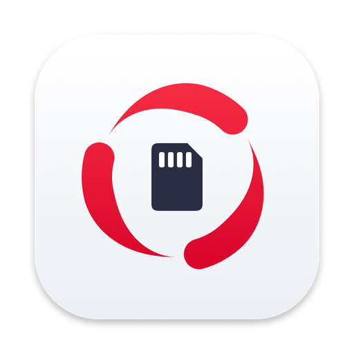
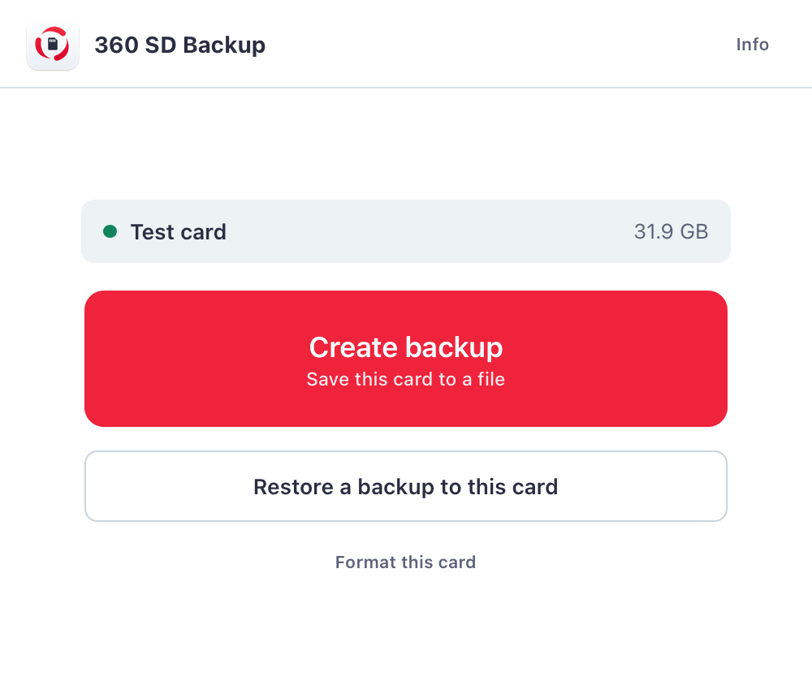
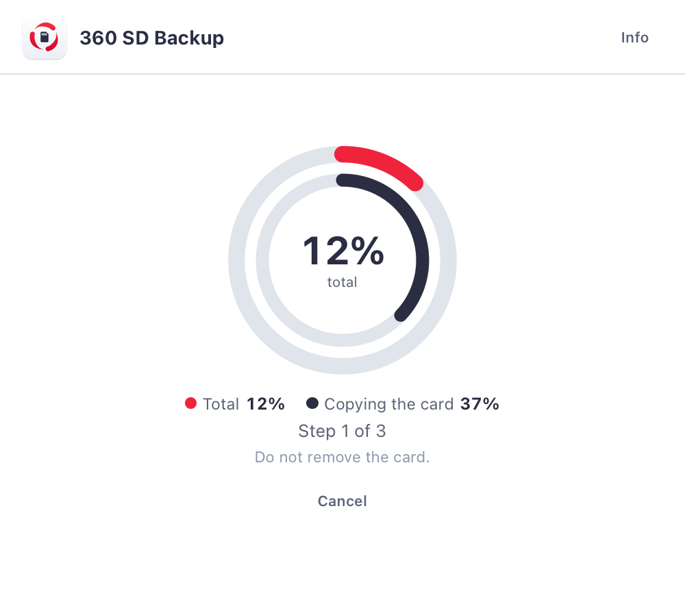
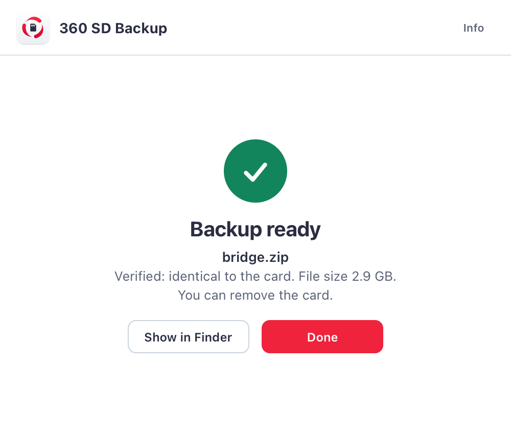

  

<h1 align="center">360 SD Backup</h1>

  <b>That tiny card holds months of your work. Protect it before it reminds you why you should have.</b>

  <a href="https://github.com/Mission-F/360-sd-backup/releases/latest/download/360-SD-Backup.dmg"><b>Download for Mac</b></a>
  &nbsp;·&nbsp;
  <a href="https://github.com/Mission-F/360-sd-backup/releases/latest/download/360-SD-Backup.exe"><b>Download for Windows</b></a>
   Free &nbsp;·&nbsp; macOS 12 or later &nbsp;·&nbsp; Windows 10 and 11 (64-bit) &nbsp;·&nbsp; about 1 MB

  

---

You already know how this ends.

Your Raspberry Pi runs for months without a single complaint. It sits in a corner and does its job. Then one day the power flickers, the micro SD gives up, and it never boots again.

And with that card go the system, the settings you fixed at two in the morning, and that one command you found after hours of trying and never wrote down.

**360 SD Backup was built for that day.** We made it because we needed it ourselves: a simple way to know that whatever happens to that card, the work on it is not lost.

Insert the card. Press one button. Done.

## A backup you can't restore is not a backup

Copying a card is easy. Knowing the copy works is another story. That is why this program doesn't trust itself:

1. It **copies** the entire card, sector by sector.
2. It **reopens the file** it just created and checks it from scratch.
3. It **reads the card a second time** and compares the fingerprints.

The file only gets its final name if everything matches. If something is off, it tells you. No half-finished backups, no surprises on the day you need one.

Restoring is just as careful: it checks the **entire** file before touching the card, then reads back everything it wrote.

  
  

## What you can do

- **Create a full backup** in a single `.zip` file, compressed and ready to archive.
- **Restore it** to another card and bring back an identical Raspberry Pi.
- **Format a card** and make it normal again, with all its space available, including cards your computer can no longer use after living in a Raspberry Pi.
- **Let it work in the background**, with progress always visible in the menu bar on Mac or in the system tray on Windows.
- **Move between Mac and Windows**: a backup made on one works on the other, because the file format is the same.

The program only shows removable cards and disks, so your computer's own disk never appears. Before erasing a card, it asks you first.

## Free. Really.

No account. No subscription. No ads. No data leaving your computer.

The interface follows your system: Italian if your system is in Italian, English otherwise.

## Installation on Mac

1. [Download the DMG](https://github.com/Mission-F/360-sd-backup/releases/latest/download/360-SD-Backup.dmg) and open it.
2. Drag **360 SD Backup** onto the **Applications** folder.
3. The first time you open it, macOS will block it. See below: it takes less than a minute, and you only do it once.

### If macOS says it can't be opened or may contain malware

Don't worry: that message appears because the program doesn't have Apple's paid signature, not because a virus was found. Only continue if you downloaded it from this page or from [360msystem.it](https://360msystem.it).

**macOS 14 or earlier.** In Applications, hold **Control**, click the program's icon, choose **Open**, then confirm with **Open**.

**macOS 15 or later** (Control-click no longer works):

1. Try to open the program and close the message.
2. Go to **System Settings > Privacy & Security**.
3. Scroll down to **Security** and click **Open Anyway**.
4. Confirm with your Mac password.

The same instructions are in the `Leggimi - Read me.txt` file inside the DMG.

To read and write the card, macOS will ask for an administrator password. The program never sees or stores it: macOS handles it.

## Installation on Windows

1. [Download 360-SD-Backup.exe](https://github.com/Mission-F/360-sd-backup/releases/latest/download/360-SD-Backup.exe). Nothing to install: just open it.
2. Windows asks for administrator permission, because the program has to read and write the whole card.

### If Windows says "Windows protected your PC"

That message appears because the program doesn't have a paid certificate, not because a virus was found. Only continue if you downloaded it from this page or from [360msystem.it](https://360msystem.it).

1. Choose **More info**.
2. Choose **Run anyway**.

Windows 10 and 11, 64-bit. It needs Microsoft Edge WebView2 Runtime, already included in Windows 11 and on almost all Windows 10 PCs. The Windows disk and NTFS disks never appear in the list.

## Before you start

- Shut down the Raspberry Pi cleanly with `sudo shutdown -h now`, then remove the card.
- If your Mac says the disk is not readable, choose **Ignore**.
- **On Windows, if it offers to format the card, always choose Cancel.** The card is fine: Windows simply can't read its Linux part. If you accept, you lose the data.
- To restore, you need a card at least as large as the original.
- A backup is a complete copy, including passwords and keys. Treat it with the same care as the card.
- Do not run the original Raspberry Pi and its clone on the same network at the same time.

## Where things stand

We would rather tell you exactly how things are. Backup, restore and format have all been confirmed on real cards from an Intel Mac: the restored card booted a real Raspberry Pi and everything worked. The Apple Silicon build is included, but so far it has only been run on Intel.

The Windows version is new. It passed our automated tests on virtual disks, including damaged files and backups larger than 4 GB, and it has been tried on a real card. Moving a backup between Mac and Windows has been checked with test files in the same format, not yet with a full real round trip.

If your data matters, try it on a spare card before you need it. That is the best advice for any backup.

## License

This program is **free but not open source**: you can download it and use it freely, including for work, under the terms in the [LICENSE](LICENSE) file. It is provided as is, without warranty.

© 2026 360 Management System. All rights reserved. For any request: supporto@360msystem.it

Apple, Mac and macOS are trademarks of Apple Inc. Microsoft and Windows are trademarks of Microsoft Corporation. Raspberry Pi is a trademark of Raspberry Pi Ltd. This project is not affiliated with or endorsed by these companies.
