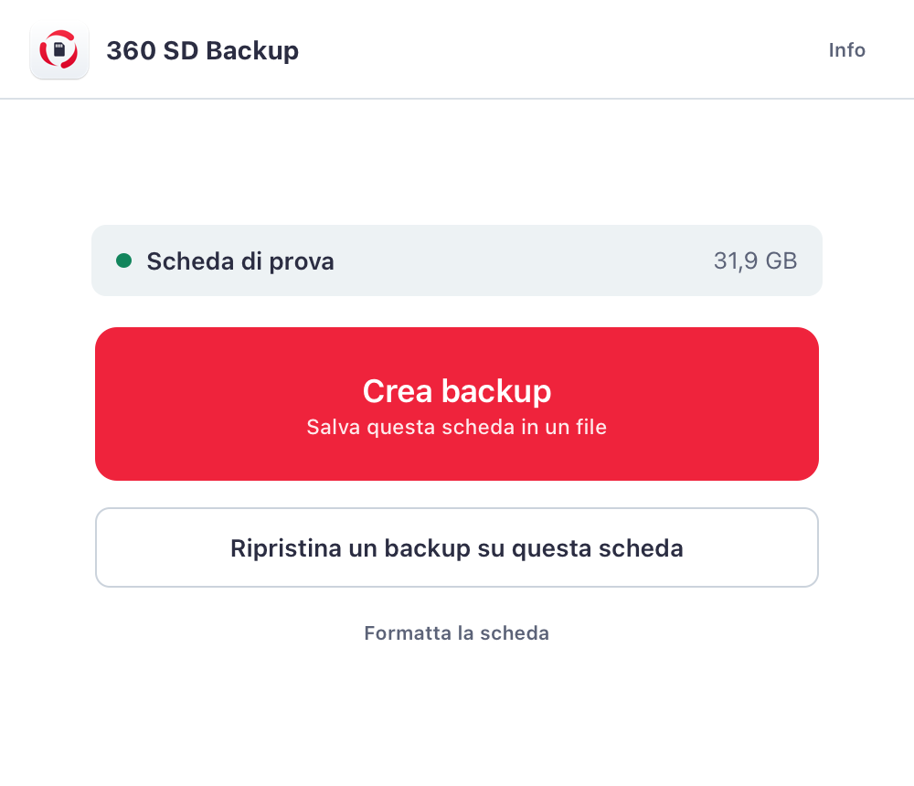
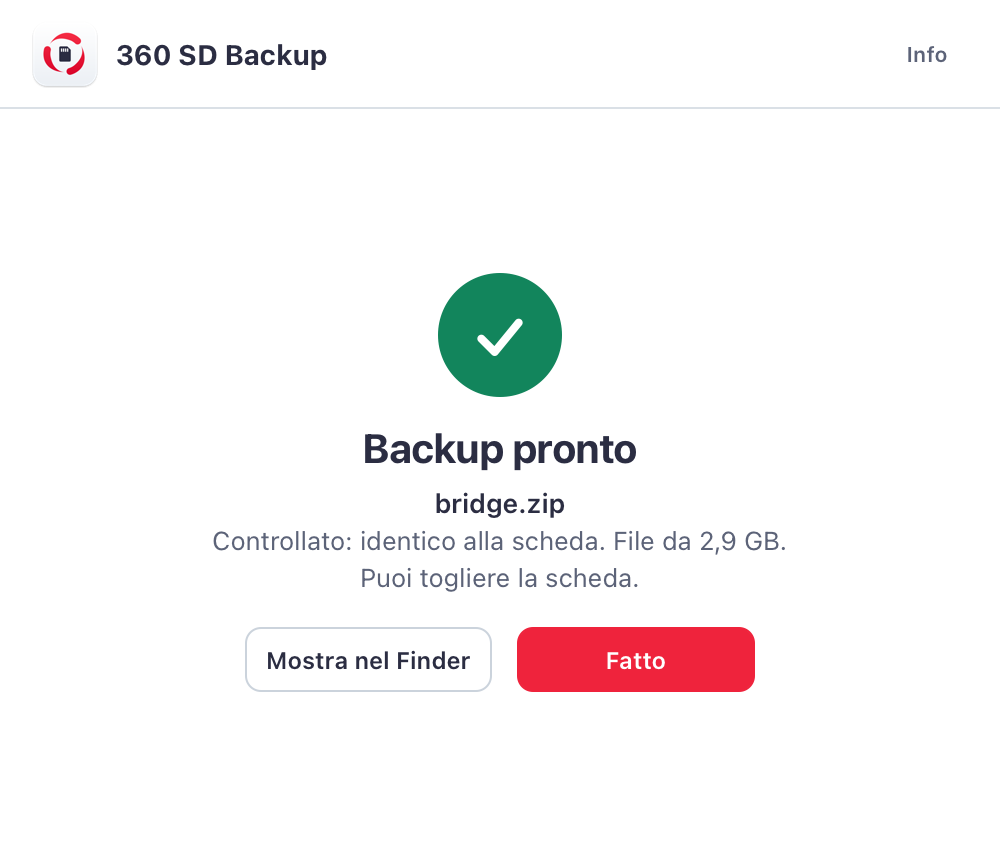

  

<h1 align="center">360 SD Backup</h1>

  <b>Quella piccola scheda contiene mesi del tuo lavoro. Mettila al sicuro prima che sia lei a ricordartelo.</b>

  <a href="https://github.com/Mission-F/360-sd-backup/releases/latest/download/360-SD-Backup.dmg"><b>Scarica gratis per Mac</b></a>
  &nbsp;·&nbsp; macOS 12 o successivo &nbsp;·&nbsp; meno di 1 MB

  

---

Sai già come va a finire.

Il tuo Raspberry Pi lavora per mesi senza un lamento. Sta lì, in un angolo, e fa il suo dovere. Poi un giorno salta la corrente, la micro SD si arrende, e lui non si riaccende più.

E con la scheda se ne vanno il sistema, le configurazioni sistemate alle due di notte, quel comando trovato dopo ore di tentativi che non ti sei mai segnato.

**360 SD Backup nasce per quel giorno.** Lo abbiamo costruito perché serviva a noi: un modo semplice per sapere che, qualunque cosa succeda a quella scheda, il lavoro che c'è sopra non è perso.

Inserisci la scheda. Premi un tasto. Fine.

## Un backup che non si può ripristinare non è un backup

Copiare una scheda è facile. Sapere che la copia funziona è un'altra storia. Per questo il programma non si fida di se stesso:

1. **Copia** tutta la scheda, settore per settore.
2. **Riapre il file** appena creato e lo controlla da capo.
3. **Rilegge la scheda una seconda volta** e confronta le impronte digitali.

Il file prende il nome definitivo solo se tutto coincide. Se qualcosa non torna, te lo dice. Niente mezzi backup, niente sorprese il giorno in cui ne hai bisogno.

Anche il ripristino è prudente: controlla **tutto** il file prima di toccare la scheda e, a fine scrittura, rilegge quanto ha scritto.

  
  

## Cosa puoi fare

- **Creare un backup** completo in un unico file `.zip`, compresso e pronto da archiviare.
- **Ripristinarlo** su un'altra scheda e rimettere in piedi un Raspberry Pi identico.
- **Formattare una scheda** e farla tornare normale, con tutto lo spazio disponibile: anche quelle che il Mac non riesce più a usare dopo essere state nel Raspberry.
- **Lasciarlo lavorare** in background: l'avanzamento resta visibile nella barra in alto.

Il programma ti mostra solo schede e dischi rimovibili, così il disco del tuo Mac non compare mai. Prima di cancellare una scheda, te lo chiede.

## Gratis, davvero

Niente account. Niente abbonamenti. Niente pubblicità. Niente dati che escono dal tuo Mac.

## Installazione

1. [Scarica il file DMG](https://github.com/Mission-F/360-sd-backup/releases/latest/download/360-SD-Backup.dmg) e aprilo.
2. Trascina **360 SD Backup** sulla cartella **Applicazioni**.
3. Alla prima apertura macOS lo bloccherà, perché il programma non ha la firma a pagamento di Apple. Vai in **Impostazioni di Sistema > Privacy e sicurezza** e premi **Apri comunque**. Basta una volta.

Per leggere e scrivere la scheda, macOS ti chiederà la password di un amministratore. Il programma non la vede e non la conserva: la gestisce macOS.

## Prima di iniziare

- Spegni il Raspberry Pi in modo pulito con `sudo shutdown -h now`, poi togli la scheda.
- Se il Mac dice che il disco non è leggibile, scegli **Ignora**.
- Per il ripristino serve una scheda grande almeno quanto l'originale.
- Un backup è una copia completa: contiene anche password e chiavi. Trattalo con la stessa cura della scheda.
- Non tenere accesi insieme il Raspberry originale e il suo clone sulla stessa rete.

## A che punto siamo

Questa è la prima versione e preferiamo dirti le cose come stanno. Il backup è stato provato su una scheda vera. Il ripristino e la formattazione hanno superato i nostri collaudi su schede virtuali, compresi file danneggiati e schede guaste simulate, ma non ancora un giro completo su un Raspberry Pi vero. La versione per Mac Apple Silicon è inclusa, ma è stata provata solo su Intel.

Se i tuoi dati contano, fai una prova su una scheda di ricambio prima di averne bisogno. È il consiglio migliore per qualunque backup.

L'interfaccia è in italiano.

## Licenza

Il programma è **gratuito ma non open source**: puoi scaricarlo e usarlo liberamente, anche per lavoro, alle condizioni del file [LICENSE](LICENSE). Viene fornito così com'è, senza garanzie.

© 2026 360 Management System. Tutti i diritti riservati. Per qualsiasi richiesta: supporto@360msystem.it

Apple, Mac e macOS sono marchi di Apple Inc. Raspberry Pi è un marchio di Raspberry Pi Ltd. Questo progetto non è affiliato né approvato da queste società.
